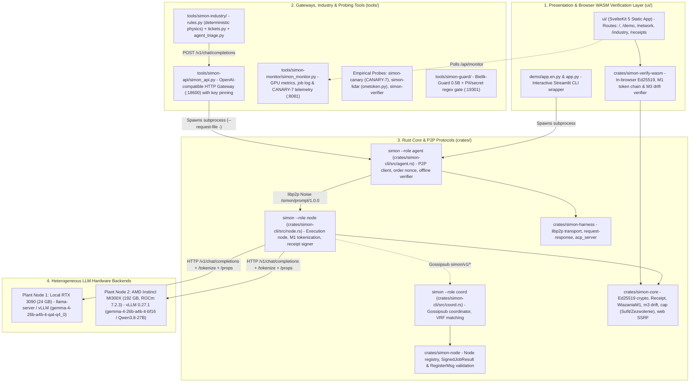
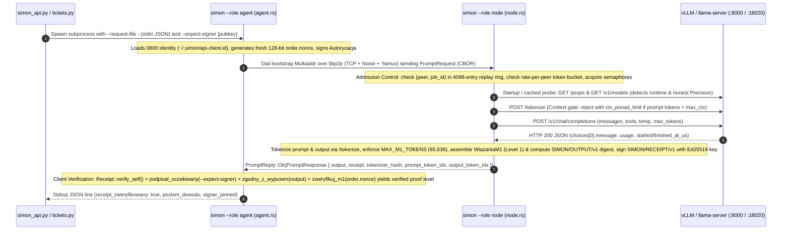
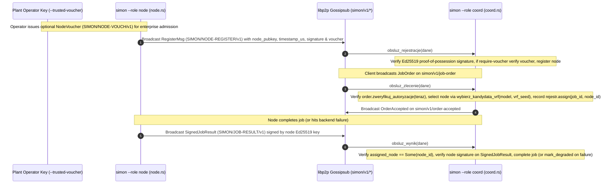
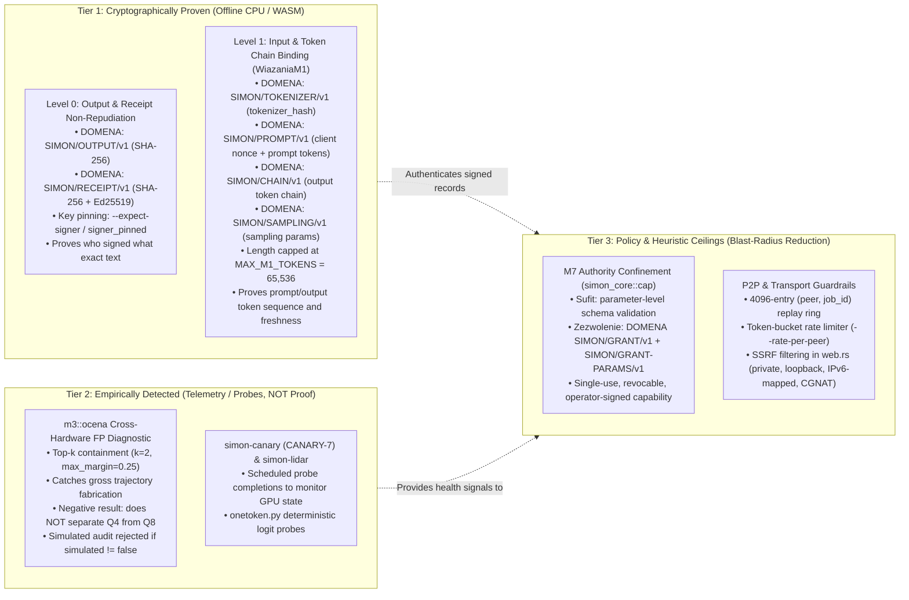

# SIMON System Architecture & Verification Hierarchy

> **Status:** Stage 2 Baseline (`fz-contrib`).  
> **Deployment Context:** Verifiable inference-result publication for small enterprise / machining plant networks (typically ~5 nodes inside a company VPN).  
> **Core Principle:** *No evidence, no status* — cryptographic guarantees, empirical telemetry, and policy mitigations are strictly separated.

---

## 1. High-Level Repository Topology

SIMON provides a verifiable publication layer for open model weights across heterogeneous hardware (e.g. NVIDIA RTX 3090 and AMD Instinct MI300X). It decouples what can be cryptographically proven offline on an ordinary CPU or browser WASM runtime from what requires empirical telemetry probes or deterministic policy ceilings.

---

## 2. Network Protocol Architecture: Dual Network Flows

The SIMON repository deliberately isolates point-to-point inference execution from asynchronous Gossipsub coordination. This separation prevents gossip flooding or coordinator downtime from blocking low-latency interactive inference.

### 2.1 Flow A: Direct Point-to-Point Inference & Receipt Pipeline

Used by `simon --role agent`, `simon_api.py`, `tools/simon-industry/`, and `demo/app.en.py`. The agent connects directly to the designated node over libp2p Noise (`/simon/prompt/1.0.0`) without passing payloads through Gossipsub.

### 2.2 Flow B: Gossipsub Coordinator & Node Registry Protocol

Used by `simon --role coord` (`crates/simon-cli/src/coord.rs`) and `crates/simon-node/src/lib.rs` for node registration, deterministic candidate selection, and job status tracking across the peer-to-peer network.

---

## 3. Cryptographic Verification & Claim Hierarchy

To preserve scientific rigor and prevent overclaiming, SIMON categorizes every capability into one of three strict tiers:

### 3.1 Domain Separator Catalog (`crates/simon-core` & `crates/simon-node`)

All hashes use SHA-256 over canonical JSON (`content_digest(&serde_json::json!({ "domena": DOMENA_*, ... }))`) without float formatting. Signatures sign the 64-character ASCII hex digest:

| Domain String | Module | Purpose |
|:---|:---|:---|
| `SIMON/OUTPUT/v1` | `receipt.rs` | Canonical digest of job output (`job_id`, `output`) |
| `SIMON/RECEIPT/v1` | `receipt.rs` | Canonical digest of full `Receipt` struct before Ed25519 signing |
| `SIMON/TOKENIZER/v1` | `receipt.rs` | SHA-256 of tokenizer definition (`0x00 \|\| bytes`) |
| `SIMON/PROMPT/v1` | `receipt.rs` | Binding of `tokenizer_hash`, `client_nonce`, and `prompt_token_ids` |
| `SIMON/CHAIN/v1` | `receipt.rs` | Sequential hash chain of `output_token_ids` |
| `SIMON/SAMPLING/v1` | `receipt.rs` | Fixed-point integer commitments for temperature, top_p, seeds |
| `SIMON/JOB-RESULT/v1` | `simon-node` | Authentication of `JobResult` (successes and failures) by assigned node |
| `SIMON/NODE-REGISTER/v1` | `simon-node` | Proof of possession signature for `RegisterMsg` on Gossipsub |
| `SIMON/NODE-VOUCH/v1` | `simon-node` | Enterprise operator voucher authorizing node admission |
| `SIMON/GRANT/v1` | `cap.rs` | Operator capability grant (`Zezwolenie`) |
| `SIMON/GRANT-PARAMS/v1` | `cap.rs` | Canonical parameter digest bound to an operator grant |
| `SIMON/OBSERVATION/v1` | `obserwacja.rs` | Observation commitment |
| `SIMON/PRACA/v1` | `pomiar.rs` | Work metric commitment |

### 3.2 Non-Claims (Strict Threat Model Boundaries)

Without a hardware Trusted Execution Environment (TEE), SIMON explicitly acknowledges:
1. **Execution is not proven:** A receipt cryptographically proves *who* signed *what* text and *what* token IDs were declared; it does not prove the model weights were actually executed on GPU.
2. **Quantization substitution is not prevented:** Same-family quantization substitution (e.g. serving Q4 weights instead of declared Q8) is not separable by output analysis alone (`docs/VERIFIER-PILOT.md`).
3. **Prompt injection is not prevented:** Capability ceilings (`Sufit`), operator grants (`Zezwolenie`), and input sanitization reduce the blast radius of injection, but do not prevent malicious instruction comprehension by LLMs.

---

## 4. Track 1: Intelligent Industry Pipeline

The Intelligent Industry pipeline demonstrates SIMON's architecture applied to predictive maintenance on the UCI AI4I 2020 Milling Dataset (10,000 telemetry rows).

```mermaid
flowchart LR
    Dataset["UCI AI4I 2020 Dataset: data/ai4i2020.csv (10,000 rows)"] --> Sample["Sample Stratification: 18 rows (15 failure modes + 3 normal runs)"]
    Sample --> RulesEngine["rules.py (Deterministic Physics Engine)<br>• Runtime: 8 ms (0 LLM tokens)<br>• Detects: HDF, PWF, OSF, TWF, RNF<br>• CHECKS catalog defines mandatory test steps"]
    
    RulesEngine -->|"No failure detected (3 normal rows)"| NoLLM["Zero LLM Invocation (Recorded as normal machine state)"]
    RulesEngine -->|"1+ failure modes detected (15 rows)"| PromptBuilder["Prompt Normalization & Sanitation<br>• Clean CSV product/type identifiers<br>• Unicode NFKC + Cf format character strip<br>• Derive physical units (W, Nm, K)"]
    
    PromptBuilder --> API["tools/simon-api/simon_api.py (:18600)<br>• --expect-signer key pinning<br>• Round-robin hardware routing"]
    
    API --> N3090["Plant Node 1: RTX 3090<br>gemma-4-26b-a4b-it-qat-q4_0"]
    API --> NMI300X["Plant Node 2: AMD MI300X<br>gemma-4-26b-a4b-it-bf16"]
    
    N3090 & NMI300X --> TriageAgent["agent_triage.py & tickets.py Guardrails<br>• Locks modes, urgency, action to rules.findings(row)[0]<br>• Replaces free text with standardized STEP_CATALOG<br>• Verified Receipt (Level 0 + Level 1 M1)"]
    
    TriageAgent --> Export["export_ui.py - Writes ui/src/lib/industry-run.json"]
    Export --> SvelteUI["/industry SvelteKit Route<br>• simon-verify-wasm in-browser verification<br>• Displays plant-listed node vs unknown node"]
```

### 4.1 Industry Pipeline Performance & Guardrails
- **Deterministic Physics Pre-Filter (`rules.py`):** Runs in 8 ms across all 10,000 rows without GPU compute. Filters out normal operation so LLM inference is invoked only when physical failure signatures (heat dissipation, power, overstrain, tool wear) are present.
- **Triage Latency:** Gemma 4 26B-A4B triage runs at measured 12–17 s per alert across local RTX 3090 and remote AMD MI300X (with per-response network medians of 1.56 s on RTX 3090 and 1.67 s on MI300X as recorded in `docs/industry/run-catalog-3090-mi300x-2026-10-15.jsonl`).
- **M7 Authority Confinement:** The model cannot invent arbitrary actions or emergency shutdowns. Proposed work orders must match `rules.findings(row)` exactly in failure mode and urgency, action codes are constrained to `(action_code, part_id)`, and technician steps must be drawn from the verified catalog.

---

## 5. Hardware Backends & Empirical Performance Matrix

Measurements are taken from committed benchmark logs in `docs/AMD-MI300X-RESULTS.md` and `docs/amd-data/`:

| Dimension | Local RTX 3090 (24 GB) | Cloud AMD Instinct MI300X (192 GB) |
|:---|:---|:---|
| **Location & Network** | Local machine (Poland, loopback / LAN) | Atlanta Datacenter (~124 ms WAN RTT from Poland) |
| **Software Stack** | Linux x86_64, llama.cpp / vLLM, CUDA | Ubuntu 22.04, ROCm 7.2.3, vLLM 0.27.1 (`gfx942`) |
| **Model Evaluated** | Gemma 4 26B-A4B QAT Q4_0 / Qwen3.8-27B Q4 | Gemma 4 26B-A4B BF16 / Qwen3.8-27B BF16 |
| **Peak Concurrency** | 4 streams (87.9 tok/s total, 25.2 tok/s/stream) | **64 concurrent streams** (1998.8 tok/s total, 34.5 tok/s/stream) |
| **Receipt Verification** | All receipts verified (`tamper_matrix.rs`) | **510/510 receipts verified** (`c1_concurrency_20261013T113218Z.json`) |
| **Cross-Vendor FP Rate** | 5/32 prompts flagged (self-check baseline) | 5/32 prompts flagged (identical prompts flagged, zero added false positives) |

---

## 6. Key Architectural Trade-offs & Design Decisions

1. **Whole-Job Buffering vs. Token Streaming:**
   Because a node cannot compute the SHA-256 digest of `output` (`SIMON/OUTPUT/v1`) until generation has completed, `node.rs` buffers the entire completion, signs the receipt, and returns the pair together. The HTTP gateway (`simon_api.py`) emits periodic SSE keepalive comments (`: simon job running`) to prevent client timeouts, followed by the complete response and receipt.
2. **Process-per-Request Overhead:**
   Spawning `simon --role agent` per request in `simon_api.py` introduces ~14 ms median overhead on localhost (Rust startup + loopback TCP/Noise handshake). Over WAN (~124 ms RTT to MI300X), connection establishment adds 2–3 RTTs, making connection reuse a logical future optimization while keeping the process boundary isolated and crash-resilient for now.
3. **Map-Reduce vs. WAN Layer Splitting:**
   Splitting model layers across WAN introduces a network barrier per token, slowing generation by 12× to 55× (`docs/AMD-MI300X-RESULTS.md`). SIMON routes whole jobs to full models and handles long inputs via `crates/simon-cli/src/mapreduce.rs`, splitting documents into context-bounded chunks with independent signed receipts.
